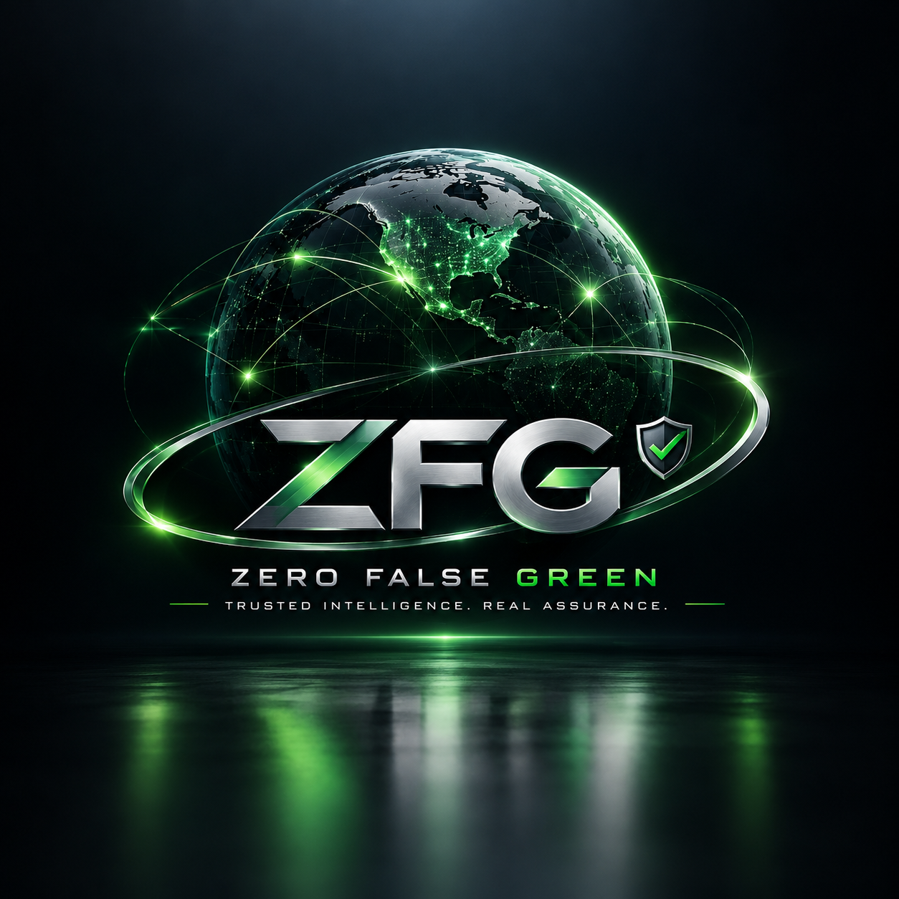

<p align="center"></p>

# Zero False Green (ZFG) for Claude

**No green without proof.** AI coding assistants often report "done", "all tests pass" or "ready to merge" when the work has not actually been checked. ZFG stops that.

With ZFG installed, Claude may only say work is passing, verified or ready when a fresh evidence receipt proves it, for the exact code on disk right now.

## Install

```text
/plugin install zfg --marketplace dennisfhall-ai/zfg-claude-plugin
```

Requires Node.js 18 or later and a git repository. No accounts, keys or network access are needed — everything runs on your machine.

## What you get

| Piece | What it does |
|---|---|
| **Zero False Green skill** | Teaches Claude the rule: no success claim without current evidence, exact claim wording, and never weakening tests to get a pass. |
| **/zfg:verify** | Runs your project's real checks (tests, lint, typecheck, build), fingerprints every file, and writes a sealed receipt to `.zfg/receipts/`. |
| **/zfg:status** | Says whether the last receipt still matches the code: `CURRENT_GREEN`, `STALE`, `CURRENT_RED`, `MISSING` or `TAMPERED`. |
| **End-of-turn guard** | If Claude's reply claims success without a current GREEN receipt, Claude is sent back once to run the checks or restate the claim as unverified. |

## Verdicts

- **GREEN** — at least one real check ran, every check passed, and no file changed during the run.
- **RED** — a check failed. The receipt names it and keeps the last lines of its output.
- **BLOCKED** — nothing was proven: no checks found, a check timed out, the config is broken, or files changed mid-run.

Any edit, new file, deleted file or new commit after a run makes the receipt **STALE**.

## Choosing the checks

ZFG detects common setups (`npm`/`pnpm`/`yarn` scripts `test`, `lint`, `typecheck`, `build`; `pytest`; `cargo test`; `go test`). npm's default placeholder test script is ignored, not counted as a pass. To choose exactly what runs, add `.zfg.json` at the project root:

```json
{
  "checks": [
    { "name": "test", "run": "npm test" },
    { "name": "e2e", "run": "npx playwright test", "timeout_ms": 1200000 }
  ]
}
```

To turn the end-of-turn guard off for a project, add `"hook": "off"` to `.zfg.json`, or set `ZFG_HOOK=off`.

## What ZFG does not claim

- A receipt is **local, self-run evidence**: your checks passed on this code, on this machine. It is not independent certification, a security audit, or release approval.
- The seal detects accidental or casual edits to a receipt. It is not a cryptographic signature and does not stop someone deliberately forging one.
- ZFG is only as strong as your checks. If the tests don't cover something, a GREEN says nothing about it.

Independent, signed release authority is the job of the full ZFG platform from DFH Software and Development Company.

## Safety note

`/zfg:verify` runs the commands listed in `.zfg.json` or your package scripts — the same commands `npm test` would run. Only verify projects you trust, just as you would before running their tests.

## Privacy

ZFG reads files in your repository to fingerprint them and stores receipts in `.zfg/` inside the project (ignored by git automatically). Nothing is sent anywhere.

## License

Free to use under the **ZFG Community License 1.0** (see `LICENSE`): install and run ZFG on your own machines and CI, for personal or commercial work, at no cost. Redistribution, modified versions, competing products and hosted resale are not permitted without written permission from DFH Software and Development Company.

Version 0.1.0 was released under the MIT License; copies of 0.1.0 received under MIT keep those rights. Version 0.2.0 and later are covered by the ZFG Community License.

Signed receipts, public verification, merge gates and team features are paid ZFG services (https://zerofalsegreen.com). "Zero False Green", "ZFG" and the ZFG logo are trademarks of DFH Software and Development Company.
